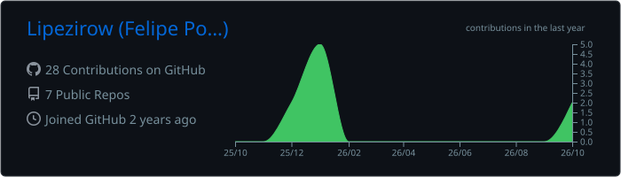
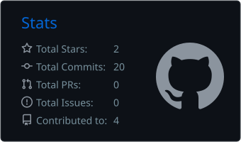
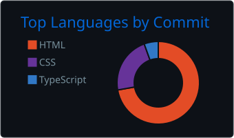
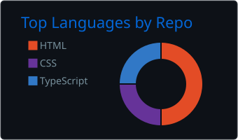
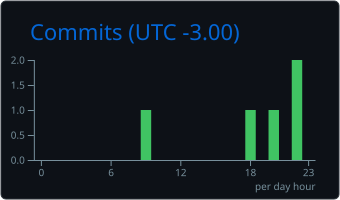

 

---

### Sobre mim

- Desenvolvedor full-stack, hoje construindo o **FitBilling** e o **Esquadrão Fit** no [Group-Desenvolvimento](https://github.com/Group-Desenvolvimento).
- Transformo regra de negócio em produto: interface caprichada, dados confiáveis e código fácil de manter.
- Estudo Análise e Desenvolvimento de Sistemas na **PUC Minas**.
- A maior parte do meu código está em repositórios privados; abaixo, o que estou construindo.

### No que estou trabalhando

<table>
  <tr>
    <td width="50%" valign="top">
      <h4>FitBilling</h4>
      Plataforma comercial e de cobrança: fila de ligação com discador, tarefas do time,
      checkout, recorrência e dashboards do funil de vendas (quiz → oferta → pagamento).
        
      
      
      
      
    </td>
    <td width="50%" valign="top">
      <h4>Esquadrão Fit</h4>
      Ecossistema de emagrecimento e treino: app nativo iOS/Android (HealthKit e Health Connect),
      app web, painel de gestão, bot de promoções e uma API de macros nutricionais.
        
      
      
      
      
    </td>
  </tr>
</table>

### Stack

  

### Números

  

  
  

  
  

  

  <picture>
    <source media="(prefers-color-scheme: dark)" srcset="https://raw.githubusercontent.com/Lipezirow/Lipezirow/output/github-snake-dark.svg" />
    
  </picture>

